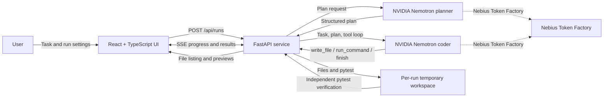

# PatchPilot

**Runs on Nebius Token Factory using NVIDIA Nemotron-3-Ultra-550b-a55b (planner) and NVIDIA Nemotron-3-Nano-30B-A3B (coder).**

PatchPilot turns a plain-language coding task into a planned, implemented, and
independently tested Python project. It provides a React workspace with
structured planning, live agent activity, generated-file previews, and
test-verification feedback.

## The problem

Prototyping a coding idea usually means translating a vague request into a
workable plan, creating the right files, writing tests, running them, and
debugging failures. That loop is repetitive and can make it difficult to tell
whether an AI-generated result is actually verified.

PatchPilot puts the loop in one place. A planner structures the work; a coding
agent writes files and runs tests; the backend independently checks the final
pytest result before reporting success. Failed checks are returned to the agent
for repair within the configured iteration budget. The UI shows what the agent
is doing, what it changed, what tests reported, and what the user can do next.

## Demo

> **Runs on Nebius Token Factory using NVIDIA Nemotron-3-Ultra-550b-a55b (planner) and NVIDIA Nemotron-3-Nano-30B-A3B (coder).**

Try a sample task such as “Build an LRU cache with O(1) get/put operations and
pytest tests.” The dashboard displays the structured plan, agent progress,
test output, and generated files for review.

## Architecture



The browser talks only to FastAPI. Provider credentials stay in the server
environment and are never returned to the UI. Each run gets a unique temporary
workspace. SSE events carry the plan, phases, file writes, command results,
verification failures, and final status. When the model calls `finish`, FastAPI
runs pytest independently; the build is successful only when pytest exits
successfully and at least one test passes.

### Stack

| Layer | Technology |
| --- | --- |
| User interface | React, TypeScript, Vite |
| API and run orchestration | Python, FastAPI, Uvicorn |
| Model API | OpenAI-compatible client to Nebius Token Factory |
| Default planner | NVIDIA Nemotron-3-Ultra-550b-a55b |
| Default coder | NVIDIA Nemotron-3-Nano-30B-A3B |
| Verification | pytest in the per-run workspace |
| Container | Multi-stage Node frontend build and Python runtime |

## Quick start with Docker

1. Copy the sample environment file and add your Nebius Token Factory key:

   ```powershell
   Copy-Item .env.example .env
   notepad .env
   ```

   Set `NEBIUS_API_KEY` to your own key. Keep `.env` private; it is excluded from
   the Docker build context and Git.

2. Build and start the application from the project root:

   ```powershell
   docker build -t patchpilot .
   docker run --rm --name patchpilot -p 8000:8000 --env-file .env patchpilot
   ```

3. Open [http://localhost:8000](http://localhost:8000). Check
   [http://localhost:8000/api/health](http://localhost:8000/api/health) for the
   API health endpoint.

On Windows, make sure Docker Desktop is running with Linux containers enabled
before building. The container starts as a non-root user. Stop it with
**Ctrl+C** or `docker stop patchpilot`.

## Run locally without Docker

### Requirements

- Python 3.11 or newer
- Node.js 20 LTS or 22 or newer and npm (Vite does not support Node.js 21)
- A Nebius Token Factory API key with access to the configured models

### Setup

From the project root, create `.env` using `.env.example` and set
`NEBIUS_API_KEY`. Then install backend dependencies:

```powershell
py -3.11 -m venv .venv
.\.venv\Scripts\python.exe -m pip install -r requirements.txt
```

Install the frontend and launch the app:

```powershell
cd frontend
npm ci
npm run dev
```

`npm run dev` starts FastAPI on port 8000 if it is not already healthy, then
starts Vite. Open the URL printed by Vite (normally
[http://127.0.0.1:5173](http://127.0.0.1:5173)). Keep the terminal running
while using the app. Press **Ctrl+C** to stop the development servers.

For a single-server local build, run `npm run build` from `frontend/`, then
start FastAPI from the project root:

```powershell
.\.venv\Scripts\python.exe -m uvicorn app:app --host 127.0.0.1 --port 8000
```

Open [http://127.0.0.1:8000](http://127.0.0.1:8000).

## Configuration

| Variable | Purpose | Default |
| --- | --- | --- |
| `NEBIUS_API_KEY` | Server-side authentication to Nebius Token Factory. Required to run a task. | None |
| `PLANNER_MODEL` | Planner model identifier. | `nvidia/Nemotron-3-Ultra-550b-a55b` |
| `CODER_MODEL` | Coding and repair model identifier. | `nvidia/NVIDIA-Nemotron-3-Nano-30B-A3B` |

You can change the model IDs and iteration limit in the run settings. The old
coder alias `nvidia/Nemotron-3-Nano-30B-A3B` is normalized to the supported
default ID.

## Benchmark

No live model benchmark has been run as part of this repository packaging, so
model performance numbers are intentionally **not reported**. The agent
benchmark invokes the configured Nebius models, consumes API tokens, and can
take several minutes.

| Benchmark | Workload | Result | Reproduce |
| --- | --- | --- | --- |
| Local backend tests | API, agent path handling, verification, and failure cases | **15 passed** in the packaging validation run | `.\.venv\Scripts\python.exe -m pytest .\tests -q` |
| Agent task benchmark | Token bucket, expression parser, interval merge, Trie, CSV-to-JSON | Not measured for this release | `.\.venv\Scripts\python.exe .\bench.py` |

The agent benchmark prints a Markdown table with per-task pass/fail, iterations,
elapsed seconds, and token counts, then prints an aggregate pass rate. It exits
non-zero if any task fails. To compare runs, use the same task list, model IDs,
iteration limit, and provider configuration; record the date and model IDs with
the output. Benchmark figures are dependent on model availability and API
response variability, so they should not be compared across different settings
as if they were identical conditions.

## Tests and build

Run backend tests from the project root:

```powershell
.\.venv\Scripts\python.exe -m pytest .\tests -q
```

Type-check and build the React production frontend:

```powershell
cd frontend
npm ci
npm run build
```

## API overview

| Method | Route | Purpose |
| --- | --- | --- |
| `GET` | `/api/health` | API health status |
| `GET` | `/api/config` | Model IDs and whether the API key is configured (never the key itself) |
| `POST` | `/api/runs` | Start a run with task, model IDs, and an iteration limit |
| `GET` | `/api/runs/{run_id}/events` | Stream run events over Server-Sent Events |
| `GET` | `/api/runs/{run_id}/files` | List files generated by a run |
| `GET` | `/api/runs/{run_id}/files/{path}` | Preview a bounded UTF-8 text file |

Run state is held in API process memory and resets when that process restarts.
Completed runs are retained only up to a bounded in-memory history.

## Safety and limitations

The run workspace is a temporary directory, **not** an operating-system
sandbox. Generated Python source and tests execute as the user running the
application. The tool interface restricts subprocess commands, and write paths
are constrained to the run workspace, but these controls do not make arbitrary
model-generated code safe. Review generated code before using it. Do not expose
this local development service to untrusted users; a hosted deployment should
run each agent task in a hardened container or VM with strict CPU, memory,
filesystem, process, and network isolation.

## Project layout

```text
.
├── agent.py                 # Planner/coder loop and isolated-per-run workspace handling
├── app.py                   # FastAPI endpoints, SSE, and generated-file access
├── bench.py                 # Reproducible live model task benchmark
├── requirements.txt         # Python dependencies
├── tests/                   # Backend unit and API tests
└── frontend/
    ├── src/App.tsx          # React workflow and run dashboard
    ├── src/styles.css       # Responsive interface
    ├── scripts/dev.mjs      # Starts API and Vite for local development
    └── package.json         # Frontend dependencies and scripts
```
